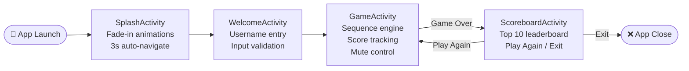
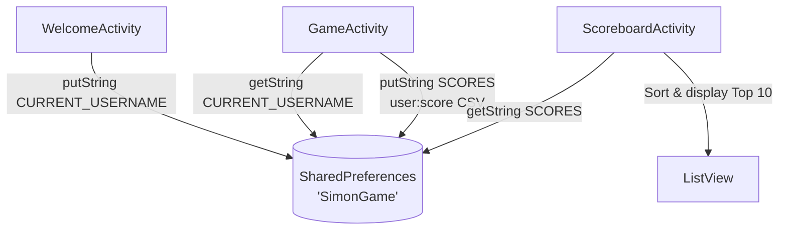

<div align="center">


# 🎮 Simon Game

### A beautifully crafted, classic memory game for Android

[](https://android.com)
[](https://www.java.com)
[-blue?style=for-the-badge)](https://developer.android.com)
[](LICENSE)
[](#)

<br/>

> *"Remember the sequence. Beat the game. Top the scoreboard."*

</div>

---

## 📱 About

**Simon Game** is a modern Android adaptation of the classic 1978 Simon electronic toy. Players must memorize and repeat an ever-growing sequence of colored button flashes. Each successful round adds one more step — see how far your memory can take you!

The game features a stunning dark UI with vibrant color buttons, smooth flash animations, DTMF tone audio feedback, and a persistent top-10 leaderboard stored on-device.

---

## ✨ Features

| Feature | Description |
|---------|-------------|
| 🎨 **Classic 4-Button Board** | Red, Green, Blue, Yellow — the iconic Simon layout |
| 🔊 **Tone Audio Feedback** | Unique DTMF tones per button for full audio immersion |
| 🔇 **Mute Toggle** | One tap to silence — mute state persists per session |
| 📈 **Progressive Difficulty** | Each round adds one more step to the sequence |
| 🏆 **Persistent Scoreboard** | Top 10 scores saved locally across sessions |
| ✨ **Animated Splash Screen** | Staggered fade-in animations on launch |
| 🌗 **Dark Theme** | Sleek OLED-friendly black background with gold accents |
| ⚡ **Instant Game-Over Feedback** | Error tone + auto-transition to scoreboard |

---

## 🖼️ Screenshots

> **Note**: Run the app on an emulator or physical device to capture screenshots. Place them in `docs/screenshots/` and they will render below.

| Splash Screen | Welcome Screen | Game Board | Scoreboard |
|:---:|:---:|:---:|:---:|
| *(Splash)* | *(Welcome)* | *(Game)* | *(Scores)* |

---

## 🏗️ Architecture

The app is structured as a clean linear Activity flow:



### Data Flow



---

## 📂 Project Structure

```
SimonGame/
├── app/
│   ├── src/main/
│   │   ├── java/com/example/simongame/
│   │   │   ├── SplashActivity.java       # Animated launch screen
│   │   │   ├── WelcomeActivity.java      # Username entry & validation
│   │   │   ├── GameActivity.java         # Core game engine
│   │   │   └── ScoreboardActivity.java   # Leaderboard display
│   │   ├── res/
│   │   │   ├── drawable/                 # Custom button drawables & icons
│   │   │   ├── layout/                   # 5 XML layout files
│   │   │   └── values/                   # Strings, colors, themes
│   │   └── AndroidManifest.xml
│   └── build.gradle.kts
├── build.gradle.kts
├── settings.gradle.kts
└── README.md
```

---

## 🛠️ Tech Stack

| Component | Technology |
|-----------|-----------|
| **Language** | Java 11 |
| **Min SDK** | API 24 (Android 7.0 Nougat) |
| **Target SDK** | API 34 (Android 14) |
| **UI** | XML Layouts with ConstraintLayout & RelativeLayout |
| **Audio** | `android.media.ToneGenerator` (DTMF tones) |
| **Persistence** | `SharedPreferences` (CSV-based score storage) |
| **Navigation** | Manual Intent-based Activity transitions |
| **Animations** | `AlphaAnimation` (fade-in effects) |
| **Build** | Gradle with Kotlin DSL (`.kts`) |
| **Dependencies** | AndroidX AppCompat, Material, CardView, ConstraintLayout |

---

## 🚀 Getting Started

### Prerequisites

- **Android Studio** Hedgehog (2023.1.1) or later
- **JDK 11** or later
- **Android SDK** with API 34 (Android 14)
- A physical Android device (**API 24+**) or emulator

### Build & Run

1. **Clone the repository:**
   ```bash
   git clone https://github.com/YOUR_USERNAME/simon-game-android.git
   cd simon-game-android
   ```

2. **Open in Android Studio:**
   - Launch Android Studio
   - Select **File → Open** and navigate to the cloned folder
   - Wait for Gradle sync to complete

3. **Set up local properties:**
   - If prompted, Android Studio will create `local.properties` with your SDK path automatically
   - **Do not commit** `local.properties` — it is already in `.gitignore`

4. **Run the app:**
   - Select a device or emulator (API 24+)
   - Press **▶ Run** (Shift+F10) or use `./gradlew installDebug`

### Build via Command Line

```bash
# Debug build
./gradlew assembleDebug

# Install directly to connected device
./gradlew installDebug

# Run lint checks
./gradlew lint
```

> **Windows users:** Use `gradlew.bat` instead of `./gradlew`

---

## 🎮 How to Play

1. **Launch** the app and watch the animated splash screen
2. **Enter your name** on the Welcome screen (letters only, no `:` or `,`)
3. Tap **"Start Game"** on the center button to begin
4. **Watch** the sequence of flashing colored buttons
5. **Repeat** the sequence by tapping the buttons in the same order
6. Each successful round adds **one more step** — don't break the chain!
7. Tap the wrong button → **Game Over** — your score is saved automatically
8. View the **Top 10 Scoreboard** and challenge yourself to climb higher

---

## 🐛 Known Issues & Roadmap

- [ ] Add difficulty levels (speed increases per round)
- [ ] Add longest streak tracking
- [ ] Accessibility: TalkBack support for color-blind users
- [ ] Cloud leaderboard (Firebase integration)
- [ ] Haptic feedback on button press

---

## 🤝 Contributing

Contributions are welcome! Please read [CONTRIBUTING.md](.github/CONTRIBUTING.md) before submitting a pull request.

---

## 📄 License

```
MIT License

Copyright (c) 2026 Simon Game Contributors

Permission is hereby granted, free of charge, to any person obtaining a copy
of this software and associated documentation files (the "Software"), to deal
in the Software without restriction, including without limitation the rights
to use, copy, modify, merge, publish, distribute, sublicense, and/or sell
copies of the Software, and to permit persons to whom the Software is
furnished to do so, subject to the following conditions:

The above copyright notice and this permission notice shall be included in
all copies or substantial portions of the Software.
```

---

<div align="center">

Made with ❤️ and a lot of memory training

⭐ **Star this repo if you enjoyed the game!** ⭐

</div>
